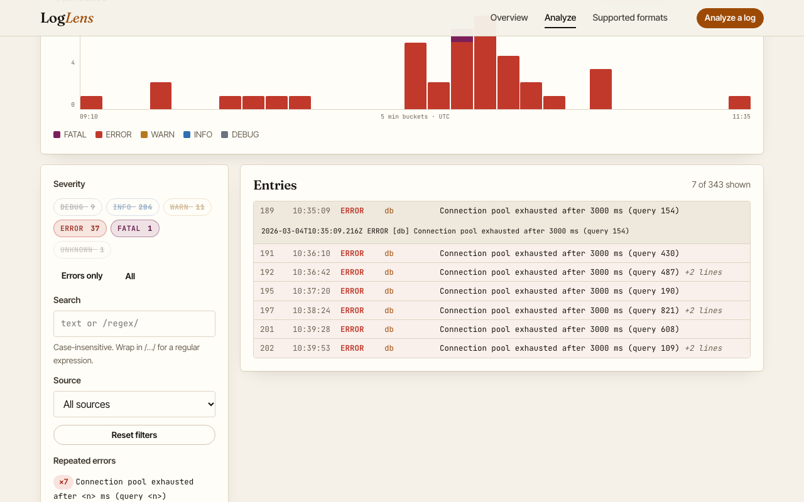
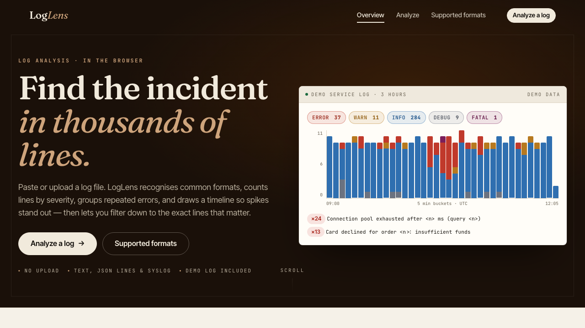
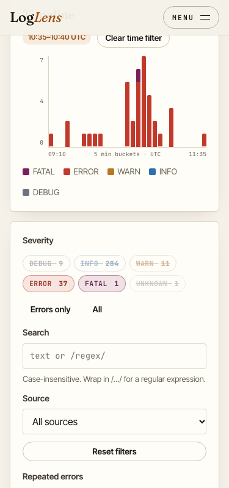

# LogLens

Analyse application logs in the browser: paste or upload a file, see counts by severity, spot spikes on a stacked timeline, zoom into a time window, filter by severity, source, text or regex, and read repeated errors grouped together.



| Landing | Mobile |
| --- | --- |
|  |  |

## Run it

```bash
npm install
npm run dev        # http://localhost:5114
npm test
npm run build
npm run test:e2e   # Playwright smoke test (npm run e2e:install once if Chromium is missing)
```

## Main workflow

1. **Analyze** opens with a labelled, generated demo log (three hours of a fictional web service, with a database incident, a FATAL failover, stack traces, JSON lines from a worker and an unparseable line).
2. Load your own: **Upload file** (.log/.txt/.jsonl up to 5 MB; binary and oversized files are rejected with a message; a “Reading…” state shows while loading) or **Paste log lines**.
3. The **timeline** stacks lines per severity in automatically sized buckets (1 min → 1 day) with axis labels, legend and tooltips. Click a bar to filter to that window.
4. Filter with severity chips (with counts), **Errors only**, text or `/regex/` search (invalid patterns are explained), and source. Click a **repeated error** group to search for it.
5. Entries show line number, time, severity, source and message; click to expand the raw line including attached stack traces. 100 per page.

## Parsing rules

See the in-app **Supported formats** page: ISO-timestamped text, JSON lines (common key names), syslog, severity aliases, stack-trace continuation. Times without a zone are treated as UTC; syslog lines assume the current year.

## Tests

- `src/lib/logs.test.ts` — text/JSON/syslog parsing, aliases, unknown lines, stack traces, level counts, level/source/text/regex/time filters, error grouping, timeline bucketing and untimed lines.
- `src/App.test.tsx` — demo analysis, severity + regex + invalid regex, paste flow and empty paste, oversized and valid file uploads, empty state.
- `e2e/smoke.spec.ts` — click the busiest error bar, errors only, expand a line, upload a JSONL file, reload persistence; strict 375px checks.

## Limitations

- Main-thread parsing; 5 MB limit; the last loaded log is stored in localStorage (very large logs may exceed browser storage and won't persist).
- No multi-line formats beyond indented stack traces; no custom format definitions.
- Error grouping is heuristic (numbers, UUIDs and quoted strings).

## Future improvements

- Web Worker parsing with streaming for larger files; user-defined line formats; export filtered lines.
